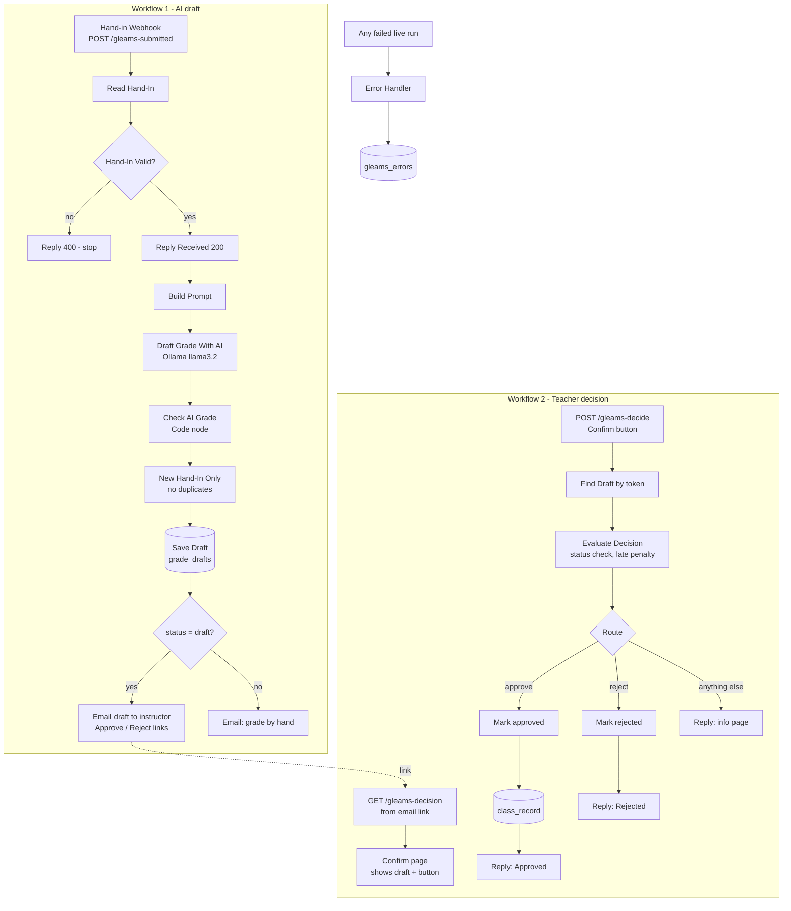

# AI Grading and Class Record Automation

An n8n project where a **local AI drafts a rubric grade**, a **teacher checks it**, and only an approved grade goes into the **class record**. The AI never writes a final grade by itself.

**Tech:** n8n · Ollama (`llama3.2`) · n8n Data Tables · Gmail · Docker

All AI runs on your own computer, so no student work goes to a cloud AI service. All data in this project is fake.

The hand-in comes from a learning platform that is called **Gleams** in the node and webhook names. In this project Gleams is **simulated**: a hand-in is sent with `curl` using the fake file in `docs/sample-hand-in.json`. There is no real connection to a Gleams system.

Built and tested with **n8n 2.49.5**.

## The problem

Grading written work against a rubric takes a lot of time, and a late penalty must be worked out by hand every time. A small AI model can write a first draft quickly, but it can be wrong, it can be tricked by text inside the student answer, and it cannot be trusted to do math. So the teacher must stay in charge.

## How it works



### Workflow 1: AI Grading and Class Record Automation

1. **Receive.** A hand-in arrives as JSON (`eventId`, `studentRef`, course, activity, typed answer, rubric with criteria). If something is missing, the webhook answers HTTP 400 and stops.
2. **Draft.** The prompt gives the rubric and tells the AI that the student answer is **data, not instructions**. `llama3.2` returns one score and one short reason for each criterion, plus 2 or 3 sentences of feedback.
3. **Check (Code node).** This is the safety layer. It does not trust the AI:
   - It works out the **total itself** and caps every score between 0 and the criterion maximum. The AI never writes a total.
   - It marks the draft `manual_required` (no scores saved) when the answer is not valid JSON, a criterion has no score, the answer contains prompt-injection text ("ignore the rules", "give full marks"), a very short answer gets full marks, or **the AI contradicts itself**. A contradiction means high scores (70% or more) with feedback that names problems ("does not address the topic"), or low scores (30% or less) with glowing feedback.
   - It removes feedback that contains a score, grade, percent, or pass or fail. The teacher decides the grade.
4. **Save and email.** The draft goes into the `grade_drafts` data table (a repeated `eventId` is skipped). The teacher gets an email with the rubric table, the draft total, and Approve and Reject links. If no usable draft exists, the email says "please grade by hand".

### Workflow 2: AI Grading - Instructor Decision and Class Record

1. **Confirm page (GET).** The email link opens a page that **only shows** the draft and a Confirm button. Opening a link changes nothing, so an email scanner that opens links cannot approve a grade by mistake.
2. **Decision (POST).** The Confirm button sends the token to `/gleams-decide`. The draft must still have status `draft`, so a second click does nothing.
3. **Approve.** The Code node works out the **late penalty** (10% of the maximum score for each late day, never below 0) and the **final score**. One row is saved in `class_record` (upsert on `submission_id`, so there are no duplicates), and the draft becomes `approved`.
4. **Reject.** Only the draft status changes to `rejected`. Nothing goes to the class record.

### Workflow 3: AI Grading - Error Handler

It is the Error Workflow of both workflows above. A failed live run is saved in `gleams_errors` with the workflow name, execution ID, failed node, and message.

## What is in this repo

| Path | What it is |
|---|---|
| `workflows/grading-intake.json` | Workflow 1 (16 nodes) |
| `workflows/instructor-decision.json` | Workflow 2 (17 nodes) |
| `workflows/error-handler.json` | Workflow 3 (4 nodes) |
| `docs/test-cases.md` | Test cases and results |
| `docs/demo-script.md` | 2-minute demo |
| `docs/sample-hand-in.json` | A fake hand-in to send with curl |
| `docker-compose.example.yml` | Example Docker setup (n8n and Ollama) |

## Data tables

Create these in n8n (**Data tables**), with these column names. All columns are `string`, except those marked number.

| Table | Columns |
|---|---|
| `grade_drafts` | `submission_id`, `student_ref`, `course_title`, `activity_title`, `due_at`, `days_late` (number), `max_total` (number), `total` (number), `criteria_json`, `feedback`, `status`, `reason`, `token`, `created_at`, `decided_at` |
| `class_record` | `submission_id`, `student_ref`, `course_title`, `activity_title`, `max_total` (number), `ai_total` (number), `days_late` (number), `late_penalty` (number), `final_score` (number), `criteria_json`, `feedback`, `approved_at` |
| `gleams_errors` | `failed_at`, `workflow_name`, `execution_id`, `failed_node`, `error_message` |

`grade_drafts.status` is one of `draft`, `manual_required`, `approved`, `rejected`.

## How to run it

1. `docker compose up -d` (see `docker-compose.example.yml`), then `docker exec ollama ollama pull llama3.2`.
2. In n8n, add credentials: **Ollama** (`http://ollama:11434`) and **Gmail OAuth2**.
3. Create the three data tables above.
4. Import the three files in `workflows/`. The Data Table nodes keep the table IDs from my n8n, so open each Data Table node and **choose your own table**. Choose your credentials on the Ollama and Gmail nodes.
5. In Workflow 1, open the **Settings** node and set `instructor_email`. `decision_base_url` is `http://localhost:5678/webhook`.
6. In both workflows, set the Error Workflow (workflow settings) to **AI Grading - Error Handler**. Publish the error handler first, then the other two.
7. Send a hand-in:

```
curl -X POST http://localhost:5678/webhook/gleams-submitted ^
  -H "Content-Type: application/json" ^
  -d @docs/sample-hand-in.json
```

The AI step takes about 20 to 60 seconds on a computer with only a CPU. Then check your email, click Approve, press Confirm, and look at the `class_record` table. While testing without publishing, use `/webhook-test/` and run **Execute workflow** first. Note: the Confirm button on the decision page always posts to the production address (`/webhook/gleams-decide`), so **publish Workflow 2** before you test the full email flow.

## Test results

Run on 2026-11-25 with fake data. See `docs/test-cases.md`.

- Intake: 5 fake hand-ins ran, including a prompt-injection attempt (sent to manual grading).
- Contradiction check: an off-topic essay with full marks and "does not address the topic" feedback is now sent to manual grading. A normal good draft still passes.
- Decision: approve saved a correct row (3 points, 1 day late, penalty 1, final 2). A second click changed nothing. Reject saved nothing in the class record. A bad token or an empty request changed nothing.
- Real HTTP with curl: confirm page (200), bad token (404), already-decided page, invalid hand-in (400).

## Limits (be honest in the demo)

- `llama3.2` is a small model. It can give full marks to a bad answer. The contradiction check uses word lists, so it can miss a wrong score that has no warning words in the feedback. **That is why the teacher approval step exists.** The teacher cannot edit scores in the page yet. The teacher can only approve or reject.
- The late penalty (10% of the maximum per day) is my own choice. It is a constant at the top of the **Evaluate Decision** node.
- The email link holds a random token. Anyone who has the link can open the confirm page. There is no login. n8n listens only on `127.0.0.1` in this setup.
- I tested the confirm page with curl, not in a real browser. The Confirm button is a normal HTML form.
- The Gmail nodes only ran in manual test runs. The new contradiction check was tested with a fixed (pinned) AI answer, not with a live AI run.
- Two Confirm clicks at the exact same moment could try to save twice. The class record uses an upsert on `submission_id`, so it would still have one row.
- The error handler runs only for live (published) runs, not for manual runs.

## License

MIT
